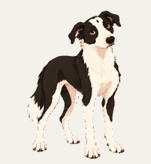

# Codex Pet Friends

Three small animated work buddies made through conversation with Codex, built-in image generation and the Pets workflow.

LONG George is the heart of this collection. She is our real black-and-white girl, translated into a cartoon work companion with her long body, long legs, uninterrupted white neck, amber eyes, crown spot and one slightly softer ear. The other two pets were playful experiments made through a similar process. They were fun. George felt different because she carried a real family story.

No original family photographs are included in this repository. Only the finished cartoon artwork is shared.

## Meet the pets

| Pet | Preview | Notes | Download |
| --- | --- | --- | --- |
| [LONG George](./long-george/) |  | Original character based on our family dog | [Download ZIP](https://github.com/ldandy/codex-pet-friends/releases/download/v1.0.0/long-george.zip) |
| [Inspired by Peach Monster Can](./inspired-by-peach-monster-can/) |  | Unofficial, non-commercial fan creation | [Download ZIP](https://github.com/ldandy/codex-pet-friends/releases/download/v1.0.0/inspired-by-peach-monster-can.zip) |
| [Inspired By Rocky from Hail Mary](./inspired-by-rocky-from-hail-mary/) |  | Unofficial, non-commercial fan creation | [Download ZIP](https://github.com/ldandy/codex-pet-friends/releases/download/v1.0.0/inspired-by-rocky-from-hail-mary.zip) |

Each download contains a validated Pets v2 sprite sheet, animated previews, descriptive metadata and a ready-to-paste installation request.

[View the complete v1.0.0 release](https://github.com/ldandy/codex-pet-friends/releases/tag/v1.0.0).

## The short version of how we made them

1. Start with photographs or a written character idea.
2. Ask Codex for three cartoon directions before producing the sprite sheet.
3. Choose one direction and describe the identity details the images do not explain.
4. Ask for the complete Pets animation set and motion previews.
5. Review the movement before upload.
6. Ask Codex to validate, hatch and activate the approved pet.

The user stays responsible for taste, identity and approval. The built-in tools handle frame layout, transparent backgrounds, the sprite contract, validation, upload and activation.

[Read George's full story and the detailed walkthrough](./STORY-AND-HOW-TO.md).

## Install one of these pets

1. Download and extract the chosen ZIP.
2. Open a ChatGPT Work or Codex conversation with the Pets tools available.
3. Attach `spritesheet.png`.
4. Paste the contents of `INSTALL.md` into the conversation.
5. Review the proposed name and description, then send the request.

Each person imports a new copy into their own account. Opening the PNG or ZIP alone does not install a pet. Pets availability depends on the account, workspace, region and product rollout.

Keep `spritesheet.png` at its original dimensions and transparency. Do not convert it to JPEG or send it through an image-compression service.

## Compatibility

All three files passed the built-in deterministic Pets validator as v2 sheets.

- Canvas size is 1,536 × 2,288 pixels
- Cell size is 192 × 208 pixels
- Layout is 8 columns × 11 rows
- Frame counts are 6, 8, 8, 4, 5, 8, 6, 6, 6, 8 and 8

## Sharing and rights

LONG George is original family artwork shared under [CC BY 4.0](https://creativecommons.org/licenses/by/4.0/). Please credit **LONG George by Lacey Dandy** and link back to this repository.

The two inspired pets are shared for personal, non-commercial fan use only. They are unofficial and are not endorsed by, sponsored by or affiliated with the owners, authors, publishers or producers of the source properties. Names, characters, trademarks and other source material remain the property of their respective owners. The wording “inspired by” is descriptive attribution, not a claim of ownership or permission.

No official logos, copied cover art or source artwork are included. See [LICENSE.md](./LICENSE.md) and [FAN-ART-NOTICE.md](./FAN-ART-NOTICE.md) before reuse.

ChatGPT, Codex and their Pets features are products of OpenAI. This is an independent community repository and is not an official OpenAI release.

