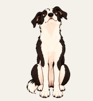

# How I turned George into a custom Codex pet using built-in tools

George now wanders around my Codex workspace while I work.

She is also our real dog.

Our black-and-white, long-legged, slightly serious fur baby is now a custom Codex pet, built from our photos with the image generation and Pets tools already available inside the app. I did not draw animation frames, build a sprite sheet or write code. I described George, reviewed the work and made the decisions only I knew enough to make.

The system did a lot. My side stayed simple.

## We started with her character, not the technical file

My first request was for three cartoon directions. I wanted George to feel like George rather than a photorealistic dog dropped into a workspace.

One concept felt right, so I picked it and removed the little Codex bandana. Then I started adding the details a photo alone would not explain.

George is a girl. She rarely wears a collar, so her long white neck patch needed to stay visible. We call her LONG George because both her body and legs are proportionately long. One ear has a white mark and sits a little softer than the other. She also has a distinctive dark spot near the top of her white head blaze.

Those details became the character brief.

They also mattered more than naming a breed or choosing an illustration trend. A generic black-and-white dog would have been technically correct and personally wrong.

## Photos gave the tools evidence. Feedback gave them meaning

I added a mix of close-ups and whole-body photos. Some showed her face markings clearly. Others showed her length, her posture and the slightly deadpan way she supervises whatever the humans are doing.

The built-in image tool used those references to make a clean cartoon version. From there, the Pets workflow produced her movement states. She idles, runs in both directions, waves, jumps, waits, works, reviews and looks around the workspace.

There was plenty of technical structure underneath. The finished sheet was 1,536 by 2,288 pixels, divided into 192 by 208 pixel cells across eleven animation rows. The workflow handled frame placement, transparent backgrounds, edge cleanup and movement continuity.

I never touched any of it.

Instead, Codex showed me the character, the contact sheet and the finished motion previews. I stayed responsible for the parts requiring judgment. Did the long body still read correctly? Was the white neck visible? Did the softer ear stay softer? Did she feel observant and affectionate rather than bouncy and generic?

Once the motion felt right, I wrote two words.

**Hatch her.**

The Pets tools validated the exact sprite sheet, prepared the upload, created LONG George and selected her as my active work companion.

## Why the process felt so simple

Simple does not mean nothing complex happened.

It means the complexity sat in the right place.

I held the context and made the choices. The tools handled repeatable production work and checked their own output against a fixed standard. There was a clear approval point before anything was uploaded or activated.

This is the part I keep coming back to with good systems work. People should not spend their attention remembering file dimensions, checking every transparent pixel or stitching dozens of animation frames together. Their attention belongs on the result and the decisions no automated check understands.

For LONG George, the technical standard mattered. Her crooked little ear mattered more.

## How to make a custom Codex pet from photos

Availability differs by plan, region, workspace and rollout. OpenAI notes the plugins and actions shown in ChatGPT or Codex depend on the account and workspace. Start by checking the Plugin directory for the Pets plugin and asking a workspace administrator if it is unavailable.

Once Pets is available, the useful part is conversational.

### 1. Attach a small set of clear photos

Include a face close-up, a full side view, a front view and one or two photos showing normal posture or personality.

Use photos owned by you or shared with permission. Check backgrounds for private information before uploading.

### 2. Ask for concepts before production

This keeps the first decision small. Try a prompt like this.

> I want to make a cartoon Codex pet from my dog. Give me three visual concepts before building the animation sheet. Keep her distinctive markings and proportions. I want a friendly cartoon style rather than photorealism.

Pick the strongest direction before asking for all the animation states.

### 3. Add the details photos do not explain

Write down the identity facts and non-negotiables.

- Sex and name
- Body and leg proportions
- Eye colour
- Coat pattern and small markings
- Ear or tail asymmetry
- Typical expression and temperament
- Accessories to include or leave out

Specific corrections are useful. “Her body and legs are both long” gave a better result than “make her longer.”

### 4. Ask for the full Pets animation and a preview

Once the character is right, continue with a direct instruction.

> Build the complete Pets sprite sheet from this approved character. Preserve her markings and proportions across every state. Show me the animation previews before uploading or activating her.

The preview step matters. A still image might look right while the moving version loses a marking, changes scale or shifts personality.

### 5. Approve and hatch

Review the movement. Ask for changes in plain language if anything feels wrong.

When it is right, ask Codex to hatch the pet and make it active. The built-in workflow handles the final validation, upload, creation and selection.

## What I would prepare before doing it again

I would gather four to six useful photos and write the non-negotiable details in one list before starting. More photos are not automatically better. Different evidence is better.

A face close-up answers one question. A standing side view answers another. A note about the ear explains what neither image quite says.

The rest is a conversation.

This started as a small, slightly silly idea. Now our fur baby keeps me company while I work, complete with the long legs, long body, white neck, crown spot and quiet supervisory stare we know so well.

The tools handled the file dimensions, animation states, validation and activation.

I handled George.

## Official references

- [Images in ChatGPT](https://help.openai.com/en/articles/11084440-images-in-chatgpt), including uploaded reference images, image generation and iterative editing
- [Plugins in ChatGPT and Codex](https://help.openai.com/en/articles/20001256), including installation, workspace controls and availability
- [Creating images with ChatGPT](https://openai.com/academy/image-generation/), including prompt guidance and the use of multiple reference images

