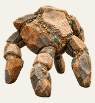

# Inspired By Rocky from Hail Mary

A clever, gentle five-limbed mineral companion with a faceted stone body, turquoise traces and musical curiosity.

This is an unofficial, non-commercial fan creation inspired by a character from the novel *Project Hail Mary*. It is not endorsed by or affiliated with the author, publisher, film producers or other rights holders. No official logo, cover art or film artwork is included.

Some look-direction poses in this original version are visually ambiguous. The standard work animations remain intact and the sprite sheet passes the structural Pets validator.

## Files

- `spritesheet.png` is the complete validated Pets v2 artwork.
- `preview.gif` cycles through all standard work states.
- `look-loop.gif` shows the directional look loop.
- `pet-info.json` records the layout and checksum.
- `INSTALL.md` contains a ready-to-paste import request.

## Reuse

Personal, non-commercial fan use only. Keep [NOTICE.md](./NOTICE.md) with shared copies. The complete repository also contains the overall [licence](../LICENSE.md) and [fan-art notice](../FAN-ART-NOTICE.md).

